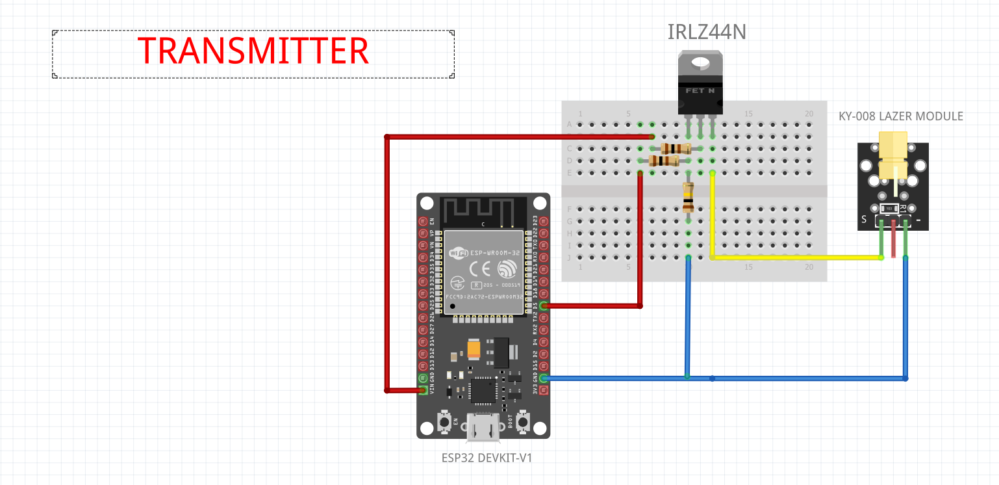
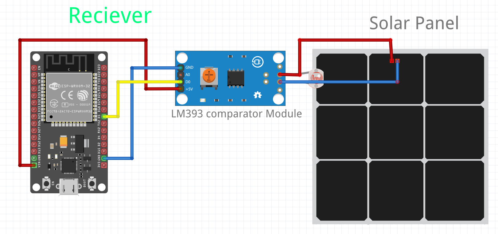

# Li-Fi Communication System

A **Light Fidelity (Li-Fi)** data transmission system built with **ESP32** microcontrollers that uses visible light (laser) to wirelessly transmit **text, images, and audio** between two devices.

## Overview

Li-Fi is an optical wireless communication technology that uses light to transmit data. This project implements a full-duplex Li-Fi link capable of sending three types of data:

- **Text** — Direct string transmission
- **Images** — JPEG/PNG files encoded as Base64
- **Audio** — Opus/MP3/WAV files encoded as Base64

Data flows through this pipeline:

```
[PC] → Serial → [ESP32 TX] → Laser Light → [Solar Panel + LM393 RX] → Serial → [PC]
```

## Circuit Diagrams

### Transmitter

The transmitter uses an **ESP32 DevKit V1**, an **IRLZ44N N-channel MOSFET**, and a **KY-008 laser module**. The ESP32 drives the MOSFET gate on GPIO 5 to modulate the laser on/off at high speed.



**Components:**
| Component | Purpose |
|---|---|
| ESP32 DevKit V1 | Main controller, receives data over serial |
| IRLZ44N MOSFET | Switches laser module at high speed |
| KY-008 Laser Module | Emits modulated light beam |
| Resistors | Gate pull-down and current limiting |

### Receiver

The receiver uses an **ESP32 DevKit V1**, a **Solar Panel** (as the light sensor), and an **LM393 Comparator Module** to convert the analog light signal into clean digital pulses.



**Components:**
| Component | Purpose |
|---|---|
| ESP32 DevKit V1 | Main controller, sends received data over serial |
| Solar Panel | Detects modulated laser light |
| LM393 Comparator Module | Converts analog light signal to digital (HIGH/LOW) |

## Project Structure

```
├── transmitter.py          # Python script — sends data to TX Arduino via serial
├── receiver.py             # Python script — reads data from RX Arduino via serial
├── arduino/
│   ├── tx_test.ino         # ESP32 transmitter firmware (laser modulation)
│   └── rx_test.ino         # ESP32 receiver firmware (LDR/solar panel reading)
├── images/
│   ├── transmitter_circuit.png
│   └── receiver_circuit.png
└── README.md
```

## How It Works

### Transmission Protocol

1. Each byte is transmitted bit-by-bit using on-off keying (OOK):
   - **Start bit** — Laser goes LOW for one period (180 µs)
   - **8 data bits** — Laser HIGH = `1`, LOW = `0` (LSB first, 180 µs per bit)
   - **Stop bit** — Laser goes HIGH for one period
2. The `#` character is used as an **end-of-transmission marker**.

### Data Flow

**Transmitter side:**
1. `transmitter.py` reads the input file (image/audio) and encodes it to **Base64**, or takes raw text input.
2. The Base64 string (with `#` appended) is sent over **serial (115200 baud)** to the TX ESP32.
3. The TX ESP32 (`tx_test.ino`) modulates the **laser** on/off to transmit each character bit-by-bit.

**Receiver side:**
1. The solar panel detects the modulated laser beam.
2. The **LM393 comparator** converts the analog signal to clean digital pulses.
3. The RX ESP32 (`rx_test.ino`) reads the digital pin, reconstructs each byte, and sends it over **serial (9600 baud)** to the PC.
4. `receiver.py` collects all received characters until the `#` marker, then decodes the Base64 data back into the original image, audio file, or text.

## Getting Started

### Prerequisites

- **Hardware:** 2× ESP32 DevKit V1, KY-008 Laser Module, IRLZ44N MOSFET, LM393 Comparator Module, Solar Panel, resistors, breadboard, jumper wires
- **Software:** [Arduino IDE](https://www.arduino.cc/en/software), Python 3.x

### Python Dependencies

```bash
pip install pyserial Pillow
```

### Setup

1. **Flash the Arduino firmware:**
   - Open `arduino/tx_test.ino` in Arduino IDE and upload it to the **transmitter** ESP32.
   - Open `arduino/rx_test.ino` in Arduino IDE and upload it to the **receiver** ESP32.

2. **Wire the circuits** as shown in the circuit diagrams above.

3. **Align the laser** so the beam hits the solar panel on the receiver side.

4. **Update the COM ports** in the Python scripts to match your system:
   - `transmitter.py` — Change `COM9` to your transmitter ESP32's port.
   - `receiver.py` — Change `COM11` to your receiver ESP32's port.

5. **Update file paths** in `transmitter.py`:
   - Modify the hardcoded image/audio file paths to point to your own files.

### Running

**Start the receiver first:**
```bash
python receiver.py
```
Select the mode (1 = Text, 2 = Image, 3 = Audio) and wait for incoming data.

**Then start the transmitter:**
```bash
python transmitter.py
```
Select the mode (1 = Image, 2 = Audio, 3 = Text) and the data will be transmitted via laser.

## Configuration

| Parameter | File | Default | Description |
|---|---|---|---|
| `PERIOD` | `tx_test.ino`, `rx_test.ino` | 180 µs | Bit duration for OOK modulation |
| `LED_PIN` | `tx_test.ino` | GPIO 5 | Pin connected to MOSFET gate |
| `LDR_PIN` | `rx_test.ino` | GPIO 5 | Pin connected to comparator output |
| Baud (TX serial) | `tx_test.ino`, `transmitter.py` | 115200 | Serial speed between PC and TX ESP32 |
| Baud (RX serial) | `rx_test.ino`, `receiver.py` | 9600 | Serial speed between RX ESP32 and PC |
| Timeout | `receiver.py` | 60 s | Seconds of silence before auto-stop |

## License

This project is open-source. Feel free to use, modify, and distribute.

